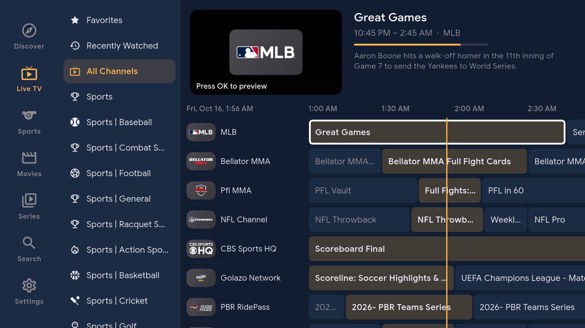
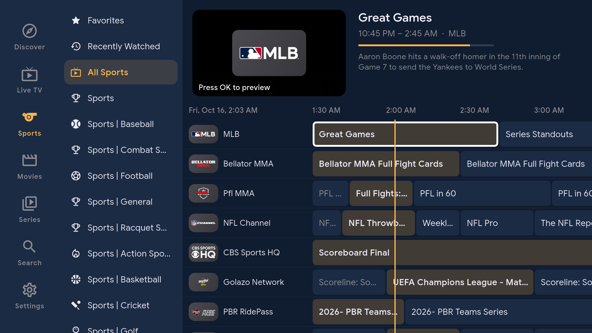
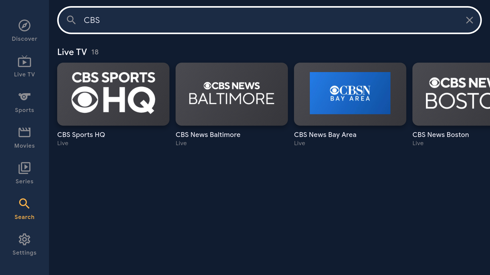
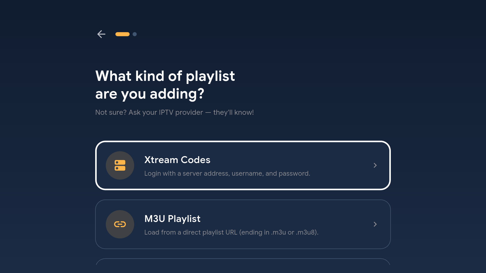
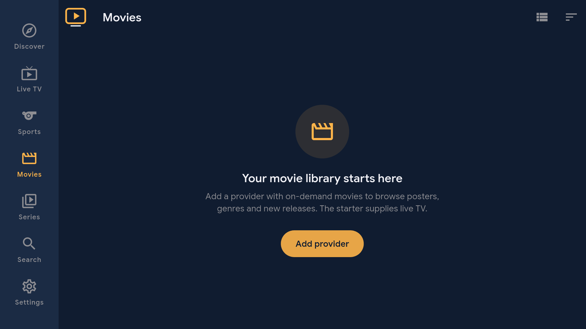

<p align="center">
  <a href="https://github.com/jeremykenedy/fire-iptv#gh-light-mode-only"><picture><source media="(max-width: 600px) and (prefers-reduced-motion: reduce)" srcset="art/banner-mobile-still-light.4bd62666c0ff.svg"><source media="(prefers-reduced-motion: reduce)" srcset="art/banner-still-light.cf5ba343cd41.svg"><source media="(max-width: 600px)" srcset="art/banner-mobile-light.fd9c0e2fe84c.svg"></picture></a>
  <a href="https://github.com/jeremykenedy/fire-iptv#gh-dark-mode-only"><picture><source media="(max-width: 600px) and (prefers-reduced-motion: reduce)" srcset="art/banner-mobile-still-dark.b4e6e2263d97.svg"><source media="(prefers-reduced-motion: reduce)" srcset="art/banner-still-dark.01f164475fb5.svg"><source media="(max-width: 600px)" srcset="art/banner-mobile-dark.e62aab811c28.svg"></picture></a>
</p>

<p align="center">A Fire TV guide and discovery app with automatic live TV setup, sports browsing, and your own movie and series libraries.</p>

<p align="center">
  <a href="https://github.com/jeremykenedy/fire-iptv/releases"></a>
  <a href="https://github.com/jeremykenedy/fire-iptv/releases/latest"></a>
  <a href="https://github.com/jeremykenedy/fire-iptv/actions/workflows/tests.yml"></a>
  <a href="LICENSE"></a>
</p>

## Table of Contents

- [Requirements](#requirements)
- [Installation](#installation)
- [Quick Start](#quick-start)
- [Features](#features)
- [Configuration](#configuration)
- [Updating and Removing](#updating-and-removing)
- [Testing](#testing)
- [Documentation](#documentation)
- [Screenshots](#screenshots)
- [Upstream](#upstream)
- [License](#license)

## Requirements

- Fire TV or Android TV running Android 7 / API 24 or newer, with a 32-bit or 64-bit ARM processor.
- Network access for streams, images and guide data.
- For the toolkit installer: macOS or Linux, Node.js 18+, and an authorized ADB connection to the TV.
- A provider with on-demand content to populate Movies and Series.

The release is physically tested on a 32-bit Fire TV running Android API 30. Other inherited OpenIPTV platforms are outside this release's tested support.

## Installation

Install [fire-tv-toolkit](https://github.com/jeremykenedy/fire-tv-toolkit), connect your TV, then run:

```bash
fire-iptv --install
```

The toolkit verifies the pinned APK checksum, installs or updates it while preserving app data, and opens the app. An existing installation is updated rather than reset. The shared player menu is also available:

```bash
firetv-iptv
firetv-iptv --app=fire-iptv --install
firetv-iptv --app=owntv --install
```

For a manual installation, download [fire-iptv.apk](https://github.com/jeremykenedy/fire-iptv/releases/latest/download/fire-iptv.apk) and install it on the TV:

```bash
adb connect <tv-ip>:5555
adb -s <tv-ip>:5555 install -r fire-iptv.apk
```

## Quick Start

1. Open fire-iptv. The bundled live catalog and Everyone profile are prepared automatically.
2. Choose **TV guide** for the channel timeline or **All sports** to filter sports channels. Guide data loads in the background.
3. Select a channel to preview it; select again for full-screen playback. Back returns to the guide.
4. Open **Add provider** to add an M3U playlist/file or Xtream Codes login for your own movies and series.
5. Use **Search**, genre rows, favorites and Continue Watching to find titles from that library.

The starter includes 1,323 public live-channel links, including 226 sports channels in its October 16, 2026 snapshot. Availability varies by channel and region. It includes no on-demand movie or series collection. Tubi and Plex shortcuts open those separate applications and their own catalogs.

## Features

- Discover tiles for the TV guide, sports and provider setup, with visible remote focus.
- A timeline guide with channel logos, categories, now/next programs and live preview.
- A dedicated sports guide with football, baseball, basketball, racing, combat sports and other available sports channels.
- Provider movie and series posters, genres, season/episode details, favorites and Continue Watching.
- Recent releases based on supplied release years, recommendations from the visible movie library, and a random movie action.
- Search across available live channels, movies, series and guide programs.
- Multiple sources and profiles, inherited parental controls, encrypted credential storage, and backup/restore.
- Offline starter installation and refresh recovery that keeps the last working catalog.
- Native Tubi and Plex shortcuts for administrator profiles on TV.
- A separately configured OwnTV alternative through the toolkit.

A public live-channel directory cannot supply every film, series, subscription network or premium sports event. [Catalog and provider documentation](docs/catalog.md) explains how the pieces fit together.

## Configuration

| Setting | Default or behavior |
| --- | --- |
| First profile | Everyone, administrator; add household profiles and PINs in Settings |
| Starter playlists | Free live TV and Samsung TV Plus |
| Refresh interval | Six hours for fresh installs |
| Guide feeds | Pluto TV US and Samsung TV Plus US XMLTV |
| Movies and Series | Empty until a source supplies on-demand content |
| Provider setup | Add provider on Discover, or Settings > Playlists |
| Catalog management | Custom sources and removed presets are preserved across updates |
| Backup | Settings > Backup & Restore |
| Updates | In-app release checks or the toolkit's pinned installer |

Do not share provider passwords in chat, issues or committed playlists. Enter them locally in the app. See [catalog configuration](docs/catalog.md) for OwnTV's playlist and guide URLs.

## Updating and Removing

```bash
fire-iptv --install     # update from the toolkit's pinned release
fire-iptv --uninstall   # remove the app and its private library
```

Back up first if you need to preserve data before removal. The application ID differs from OpenIPTV, so both can remain installed. An old OpenIPTV installation is not automatically migrated. Export and restore its backup only if you want its existing sources and settings.

`firetv-revert --all` leaves fire-iptv and OwnTV installed to preserve their libraries. Select either player explicitly in the revert checklist to remove it. The legacy `firetv-iptv --install` and `--uninstall` commands without `--app` continue to target OwnTV.

## Testing

Use Flutter 3.47.7 and the Android toolchain described in [development](docs/development.md):

```bash
flutter pub get
python3 scripts/catalog.py --check
flutter analyze
flutter test
flutter build apk --release --target-platform android-arm,android-arm64
```

CI checks the catalog, Dart analysis, tests and the ARM Android build. Native guide and playback behavior must also be checked on a TV. Release signing uses a stable private key outside the repository; see [release builds](docs/development.md#signing).

## Documentation

- [Documentation index](docs/index.md)
- [Catalog, providers and OwnTV](docs/catalog.md)
- [Development, architecture and release signing](docs/development.md)
- [Native dependency licenses](docs/THIRD_PARTY_NATIVE.md)
- [Release notes](CHANGELOG.md)

## Screenshots

Captured from the native application on a physical Fire TV. The starter has live TV; poster libraries appear after connecting a provider.

<table>
  <tr>
    <td><a href="art/screenshots/discover-tv.png"></a></td>
    <td><a href="art/screenshots/guide-tv.png"></a></td>
    <td><a href="art/screenshots/sports-tv.png"></a></td>
  </tr>
  <tr>
    <td><a href="art/screenshots/search-tv.png"></a></td>
    <td><a href="art/screenshots/provider-tv.png"></a></td>
    <td><a href="art/screenshots/settings-tv.png"></a></td>
  </tr>
  <tr>
    <td><a href="art/screenshots/movies-tv.png"></a></td>
    <td><a href="art/screenshots/series-tv.png"></a></td>
    <td></td>
  </tr>
</table>

## Upstream

fire-iptv is based on [OpenIPTV](https://github.com/Hunter-Clipper/OpenIPTV) v0.14.8. The original project provides the player, provider integrations, guide, profiles and much of the interface. This fork adds Fire TV discovery, the live-only starter, sports navigation, branding and toolkit installation. It retains the upstream history and GPL license. OwnTV is a separate application from [ahXN00/OwnTV](https://github.com/ahXN00/OwnTV).

## License

This application is open-sourced software licensed under [GPL-3.0](LICENSE).
