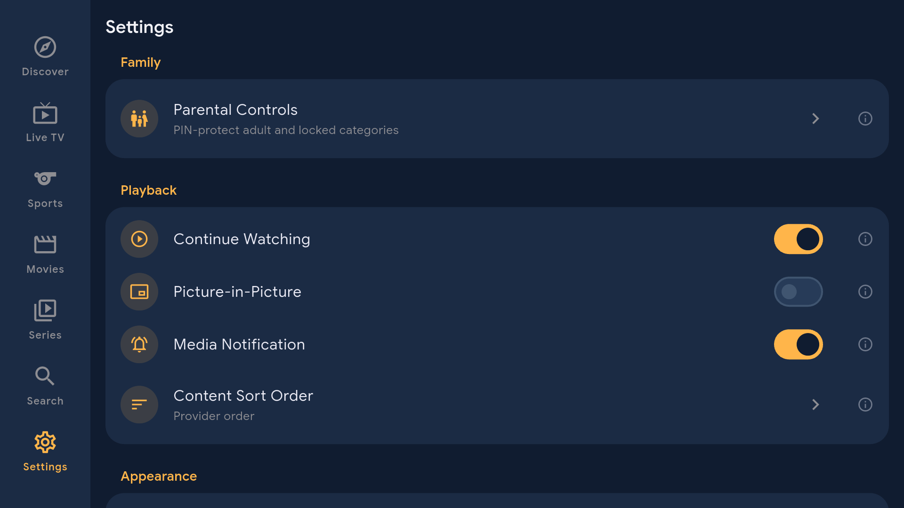

# Native screenshots

## Version 1.1.1

Physical Fire TV AFTDEC012E/API 30, October 22, 2026. These are actual 1920x1080 captures of the signed 1.1.1/code 2 update. [Capture provenance](../art/screenshots/1.1.1-captures.json) records the APK and image hashes.

<table>
  <tr>
    <td></td>
    <td></td>
    <td></td>
  </tr>
</table>

## Historical version 1.0.0 routes

These October 16 physical Fire TV captures document the earlier release. They are retained as historical route examples and do not validate the 1.1.1 PiP default or current version metadata. Live playback imagery is not included in the new capture set.

<table>
  <tr>
    <td colspan="2" valign="top"></td>
    <td colspan="2" valign="top"></td>
    <td colspan="2" valign="top"></td>
  </tr>
  <tr>
    <td colspan="2" valign="top"></td>
    <td colspan="2" valign="top"></td>
    <td colspan="2" valign="top"></td>
  </tr>
  <tr>
    <td colspan="3" valign="top"></td>
    <td colspan="3" valign="top"></td>
  </tr>
</table>
