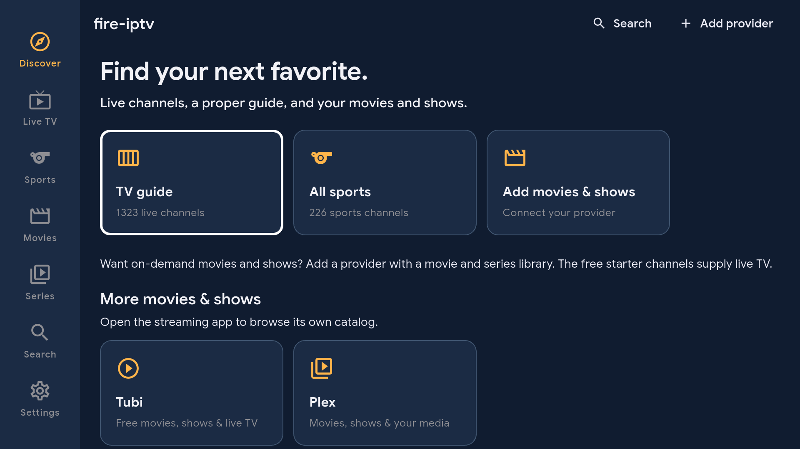
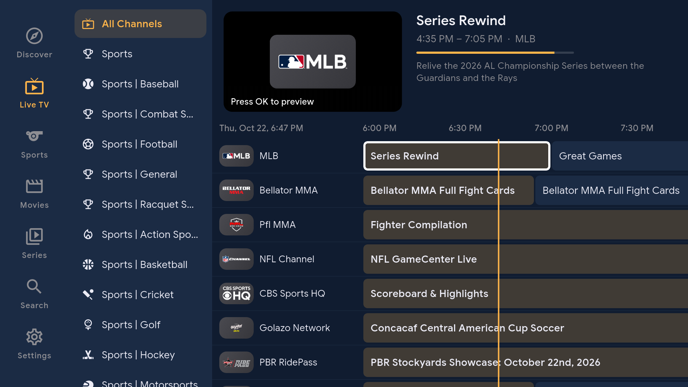
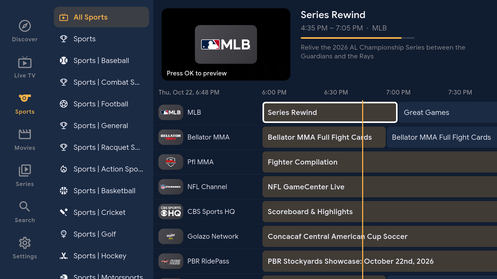
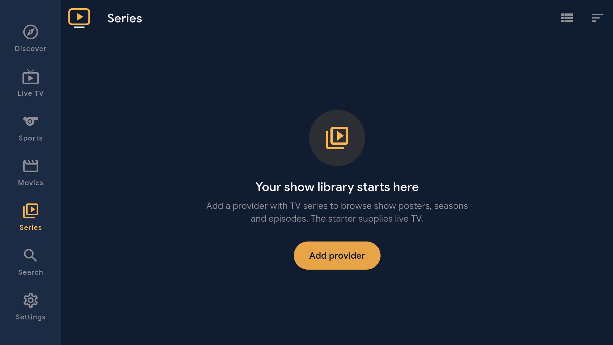
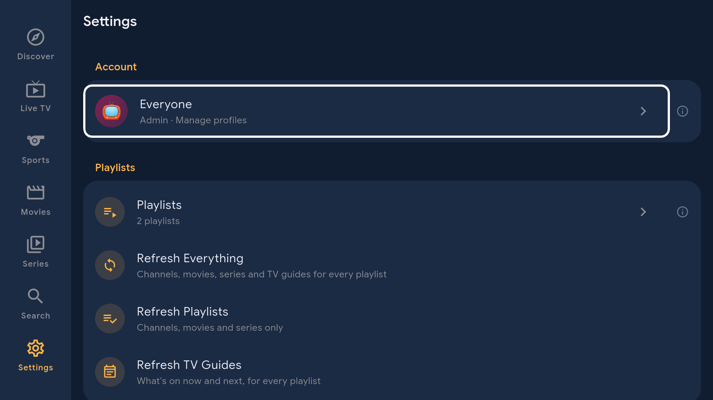
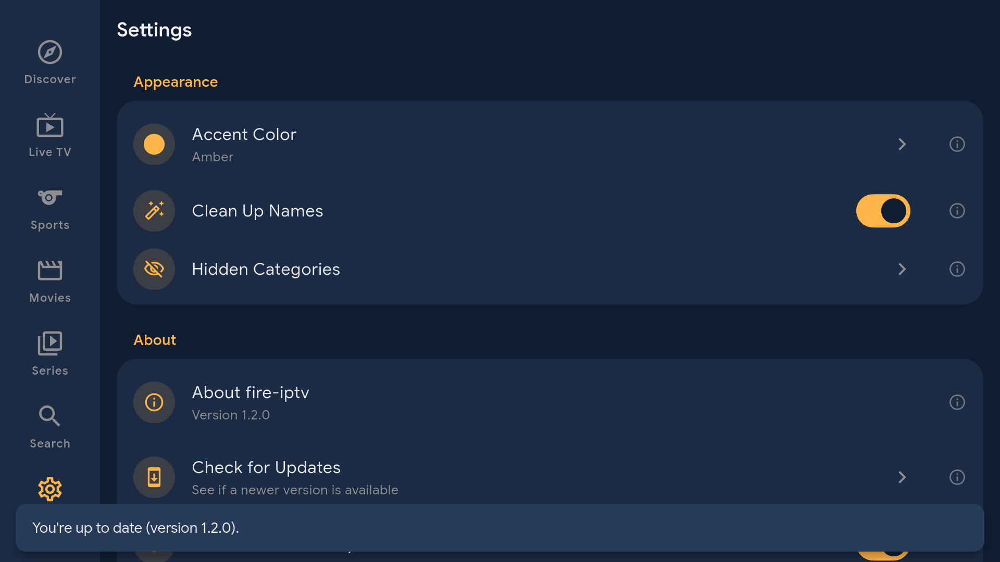

# Native screenshots

## Version 1.2.0

Physical Fire TV, October 22, 2026. These actual 1920x1080 captures show the signed 1.2.0/code 3 app with its public starter catalog. [Capture provenance](../art/screenshots/1.2.0-captures.json) records the exact APK and image hashes. Movies and Series show the starter's empty on-demand libraries; they require an owner-supplied provider. Live TV and the program guide share one route.

<table>
  <tr>
    <td></td>
    <td></td>
    <td></td>
  </tr>
  <tr>
    <td></td>
    <td></td>
    <td></td>
  </tr>
  <tr>
    <td colspan="3"></td>
  </tr>
</table>

## Earlier releases

The [1.1.1 gallery](https://github.com/jeremykenedy/fire-iptv/blob/v1.1.1/docs/screenshots.md) and [1.0.0 gallery](https://github.com/jeremykenedy/fire-iptv/blob/v1.0.0/docs/screenshots.md) document their tagged applications. They do not validate current home-card behavior.
